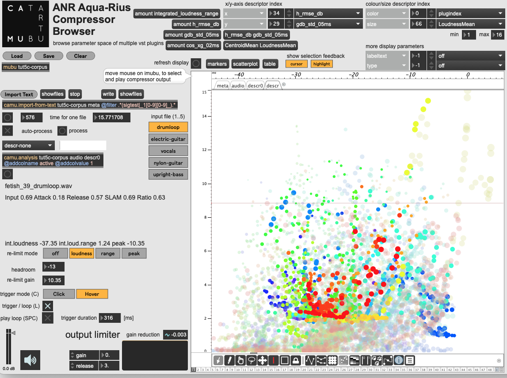

# Fifty Shades of Compression: 
Interactive Navigation in Dynamic Range Compression Plugins

Audio Dynamic Range Compression (DRC) is one of the most widely used audio effects for controlling the dynamic range of an audio signal and shaping perceived audio quality. In the field of music production, particularly during mixing and mastering, efforts have been made to standardise engineering practices. However, many plugins have idiosyncratic parameters and implementations, and parameter choices remain largely empirical and depend on the individual experience and auditory perception of sound engineers.

This work aims to fill this gap by introducing a proof-of-concept application that enables users to explore different sets of DRC profiles. These profiles are projected into a feature space designed to capture the perceptually relevant characteristics of the output audio. By navigating this space, users can compare plugins and compression settings based on features related to dynamic attributes and perceived audio quality.

We believe that this contribution can support sound engineers in selecting appropriate DRC parameters before applying compression to an audio mixture. In addition, the tool may serve pedagogical purposes by helping students and practitioners understand best practices in music production and dynamic range processing.

This repository contains

- the compressor browser prototype application `fifty-shades-of-compression-browser.maxproj`
- the dataset document `generated-all-clean.mubu`

Coming soon:

- python code to generate the dataset (definition of plugins and parameters, descriptor analysis, export to csv)

See also

- Demo video https://youtu.be/SBs1k2TefiE
- Dataset with original input sounds and compressor outputs https://zenodo.org/records/21383068
- [SMC 2026](https://smc26.mbz.hr/en/conference/) article (coming soon)
- [Supplementary material](https://zenodo.org/records/21383068/files/compressor-browser-smc2026-supplementary-material.pdf)

## How to Get Started with the Compressor Browser ##

1. Download and install Max from [https://cycling74.com/]
   - The first time you start Max, in `Options | File Preferences`, add the path to the dataset downloaded from https://zenodo.org/records/21383068
2. Open `fifty-shades-of-compression-browser/fifty-shades-of-compression-browser.maxproj`
3. In the patch, click the button `Load` and choose  `generated-all-clean.mubu`
4. Click the button next to `Refresh Display`
5. Press Space to start/stop playing
6. Move the mouse over the scatterplot to choose which output is played (press C to switch between click and hover mode)
7. Choose the input soundfile (keys 1..5)

## References

Diemo Schwarz, Remi Mignot, Come Peladeau, Haoran Sun, Etienne Demoulin, Geoffroy Peeters, Hichem Maaref, and Dominique Fourer.
Fifty Shades of Compression: Interactive Navigation in Dynamic Range Compression Plugins.
Sound and Music Computing Conference (SMC), Zagreb, Nov. 2026.

D. Schwarz, R. Mignot, C. Peladeau, H. Sun, E. Demoulin, G. Peeters, H. Maaref, and D. Fourer, “Fifty shades of compression dataset,” Jul. 2026.

## Affiliations

STMS Lab, Ircam, Sorbonne Université, CNRS, Ministère de la Culture
LTCI, Télécom-Paris, IP-Paris
IBISC,  Univ. Evry Paris-Saclay

## Acknowledgements

This research was supported by the French ANR project AQUA-RIUS (ANR-22-CE23-0022)
https://fourer.fr/aquarius/
